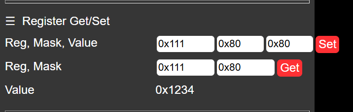

- [js代码的逻辑](#js代码的逻辑)
  - [js最重要的“***监听-触发***”的代码运作与编写逻辑](#js最重要的监听-触发的代码运作与编写逻辑)
- [全信息传输链路的寻路方式 与 物联网-硬件的代码逻辑](#全信息传输链路的寻路方式-与-物联网-硬件的代码逻辑)
- [这几段文档看下来, 感觉最适合css+html+js的学习方式](#这几段文档看下来-感觉最适合csshtmljs的学习方式)


# js代码的逻辑
既不是传统cpp的main优先, 也不是单纯的while on loop, 
而是事件驱动的
其更类似于将固定的函数注册到事件上, 当事件被触发时, 对应的函数就会被调用
而服务端在工作状态下, 会议一个较高的频率对这些事件进行轮询\监听, 来捕捉这些事件的发生并获取数据

例如
```javascript
    document.addEventListener('DOMContentLoaded', function (event) {
    const setXclkButton = document.getElementById('set-xclk')
    // 监听设置相机传感器基频的按钮点击事件'set-xclk',对应语句
    // <button class="inline-button" id="set-xclk">设置</button>
    // 当set-xclk被点击后，会生成一个click事件，进而查找并触发onclick对应定义的函数
    setXclkButton.onclick = () => {
        let xclk = parseInt(document.getElementById('xclk').value);
        // 找到id为xclk的输入框，并获取用户输入的值，转换为整数类型
        setXclk(xclk, function(code, txt){
            if(code != 200){
                alert('Error['+code+']: '+txt);
            }
        });
    }
    })
```

## js最重要的“***监听-触发***”的代码运作与编写逻辑
当你在html中定义了一个基本的button或者switch类型的input读取事件之后
你在js中通过
```javascript
const DOM_id = document.getElementById('HTML-id')
```
将对应的HTML-id所读取到的信息绑定在DOM_id上，
然后通过
```javascript
DOM_id.onEvent = () => {
    the operation you are going to handle 
    ''when server smells the event triggered
    }
```
onEvent是一个大类，常用的有
| 参数名 | 类型 |
|--------|------|
|onchange|用户改变域中的内容|
|onclick|鼠标点击某个对象|
|ondbclick|鼠标双击某个对象|
|onkeydown|某个键盘被按下|
|onkeyup|某个键盘被松开|
|onkeypress|某个键盘被按下并按住|

等等，
**需要说明的是，onEvent的变量类型是“无定义函数”的指针**:
- 服务器会根据你的onEvent的定义，订阅的相关的Event
- 而在对应元素的事件（element.event）被触发triggered之后
- 服务器会马上找到你对onEvent的函数定义并执行

不难发现，onEvent实际上是**指向函数**的“指针变量”

至于
```javascript
DOM_id.onEvent = () => {}
```
的写法,
1. ```()```里的内容是传递给函数内部的网络状态变量，常见的有(event,time.now())等等**特别注意，一般的写法不会在括号里面填入GET或者POST中的报文信息，这样会有DOM管理错误的风险**
2. ```=> {}```则是“无变量名”函数，一般的写法是在外面定义一个函数function_A，然后```=> functionA```,但是这里为了节省esp32中少得可怜的RAM空间，所以用了这种直接指向函数的方法

最后,写一个同名的用法，方便你理解它的作用
```javascript
    document.addEventListener('DOMContentLoaded', function (event) {
    const setXclkButton = document.getElementById('set-xclk')
    setXclkButton.onclick = send_SetXclk; 
    //注意上面的send_SetXclk是函数名，不要在后面加括号写成send_SetXclk(),变成立即执行函数
    function send_SetXclk()
    {
        let xclk = parseInt(document.getElementById('xclk').value);
        
        setXclk(xclk, function(code, txt){
            if(code != 200){
                alert('Error['+code+']: '+txt);
            }
        });
    }
    }
```


# 全信息传输链路的寻路方式 与 物联网-硬件的代码逻辑
这里以最容易搞混的控制命令做为讲解示例\
首先需要明确的一点是\
源代码中涉及 数值更改&读取 的指令有三条uri种类\
分别是
```cpp
httpd_register_uri_handler(camera_httpd, &reg_uri);
httpd_register_uri_handler(camera_httpd, &greg_uri);
httpd_register_uri_handler(camera_httpd, &cmd_uri);
```
我们通过基本的索引检查发来寻找对应函数\
同时注意每个函数坐在的 ***文件位置***：
   - 对应其在服务器端还是客户端？
   - 如果是在客户端，实在html-exhibition还是js-trigger-logic位置？
   - 如果是在服务端，对应了网络通信与报文传递功能？还是进行了硬件操作？

----
**三个对应的链路传递过程**:
1. **reg_uri**
    - 在***httpd_app.cpp***中\
        <mark>以**分域类reg_uri**为索引</mark>，找到```httpd_uri_t reg_uri```\
        所圈定的的主域名路径为```.uri = "/reg",```\
    - 在***index_ov2640.html的js部分中***\
        <mark>以**域名/reg**为索引</mark>，找到对应的处理函数为\
        ```setReg(reg, offset, mask, value, cb)```\
        主要作用语句为
        ```js
        fetchUrl(`${baseHost}/reg?reg=${reg}&mask=${mask}&val=${value}`, cb);```
    - 而在***index_ov2640.html的js部分中的***\
        <mark>以**函数名setreg**为索引</mark>，找到所绑定的```onEvent```为```onclick```
        ```js
        const setRegButton = document.getElementById('set-reg')
        setRegButton.onclick = () => {
        ```
    - 最后在***index_ov2640.html的html部分中的***\
        <mark>以id="set-reg"为索引</mark>，找到隶属于\
        ```<div class="input-group" id="set-reg-group">```的代码块\
        其是属于index_ov2640.html的html部分中的*745~832行*的**advanced settings**的代码块
2. **greg_uri**
    这个我们反着来，已知html中的调用代码块，如何找到handler函数与具体操作
    - 在网页标记文本***index_ov2640.html的html部分中***
        根据页面的元素

        
        
        找到对应的html代码
        ```html
        <!--h4>Get Register</h4-->
        <div class="input-group" id="get-reg-group">
            <label for="get-reg">Reg, Mask</label>
            <div class="text">
                <input id="get-reg-addr" type="text" minlength="4" maxlength="6" size="6" value="0x111">
            </div>
            <div class="text">
                <input id="get-reg-mask" type="text" minlength="4" maxlength="6" size="6" value="0x80">
            </div>
            <button class="inline-button" id="get-reg">Get</button>
        </div>
        <div class="input-group">
            <label for="get-reg-value">Value</label>
            <div class="text">
                <span id="get-reg-value">0x1234</span>
            </div>
        </div>
        ```
    - 紧接着根据语句```<button class="inline-button" id="get-reg">Get</button>```
        中的<mark>id="get-reg"</mark>为索引\
        在文件***index_ov2640.html的js部分中***中找到\
        ```js
        const getRegButton = document.getElementById('get-reg')
        getRegButton.onclick = () => {
            let reg = parseInt(document.getElementById('get-reg-addr').value);
            let mask = parseInt(document.getElementById('get-reg-mask').value);
            let value = document.getElementById('get-reg-value');

            getReg(reg, 0, mask, function(code, txt){
            if(code != 200){
                value.innerHTML = 'Error['+code+']: '+txt;
            } else {
                value.innerHTML = '0x'+parseInt(txt).toString(16)+' ('+txt+')';
            }
            });
        }
        ```
    - 可以看到其主要操作函数是getReg，同样继续以<mark>getReg</mark>为索引，在文件***index_ov2640.html的js部分中***中找到getReg的定义如下
        ```js
        function getReg(reg, offset, mask, cb){
            mask = mask << offset;
            fetchUrl(`${baseHost}/greg?reg=${reg}&mask=${mask}`, function(code, txt){
            let value = 0;
            if(code == 200){
                value = parseInt(txt);
                value = (value & mask) >> offset;
                txt = ''+value;
            }
            cb(code, txt);
            });
        }
        ```
    - 其发送的远程请求下的主域名的类为```fetchUrl(`${baseHost}/greg?reg=${reg}&mask=${mask}`, ```中的<mark>/greg</mark>
        以此为索引，在ESP32的服务器编译文件***app_httpd.cpp***中找到其对应大类
        ```cpp
        httpd_uri_t greg_uri = {
                .uri = "/greg",
                .method = HTTP_GET,
                .handler = greg_handler,
                .user_ctx = NULL
        #ifdef CONFIG_HTTPD_WS_SUPPORT
                ,
                .is_websocket = true,
                .handle_ws_control_frames = false,
                .supported_subprotocol = NULL
        #endif
            };
        ```
    - 在其中定义的handler函数为<mark>greg_handler</mark>，最后以此为索引，在esp32的硬件功能编译文件***app_httpd.cpp***中，找到其具体的固件操作如下
        ```cpp
        static esp_err_t greg_handler(httpd_req_t *req)
        {
            /*
                根据req的请求，读取寄存器下存储的相机状态对应的值，并返回给客户端
            */
            char *buf = NULL;
            char _reg[32];
            char _mask[32];

            if (parse_get(req, &buf) != ESP_OK) {
                return ESP_FAIL;
            }
            if (httpd_query_key_value(buf, "reg", _reg, sizeof(_reg)) != ESP_OK ||
                httpd_query_key_value(buf, "mask", _mask, sizeof(_mask)) != ESP_OK) {
                free(buf);
                httpd_resp_send_404(req);
                return ESP_FAIL;
            }
            free(buf);

            int reg = atoi(_reg);
            int mask = atoi(_mask);
            sensor_t *s = esp_camera_sensor_get();
            int res = s->get_reg(s, reg, mask);
            if (res < 0) {
                return httpd_resp_send_500(req);
            }
            log_i("Get Register: reg: 0x%02x, mask: 0x%02x, value: 0x%02x", reg, mask, res);

            char buffer[20];
            const char * val = itoa(res, buffer, 10);
            httpd_resp_set_hdr(req, "Access-Control-Allow-Origin", "*");
            return httpd_resp_send(req, val, strlen(val));
        }
        ```

        可以看到，这一段是非常底层的，需要对着固件物理地址和固态地址一点点编译的，具体到硬件地址的注册值和掩码的 数据修改与读取操作，属于是为原厂工作人员预留的开发接口

注意上面的功能查找过程，绝大部分逻辑混乱的\
```
┌─────────────────┐     HTTP        ┌─────────────────┐
│   html->js      │ ──────────────► │   cpp->ino      │
└─────────────────┘                 └─────────────────┘
```
代码,\
都可以通过这个方法一步步反推得到全逻辑链路，并跳转到具体的作用函数，修改其对应功能


-----
---------
---------
----------
--------
--------
-------
----
但是由于数据的实时性以及为了节省单片机等内存紧张设备的内存资源, 
许多函数和数据并不会采用include头文件的方式封装在外部, 而是直接写在script里面

这就很麻烦了, 许多函数的定义和调用都散落在各个事件的回调函数中,
许多定义是实时的匿名或者临时生成的定义，这包括了各种参数虚函数操作
许多函数都是匿名函数, 也就是说没有名字,
特别是由于所有事件的回调函数都被注册到同一个事件上,
导致相对不规范的函数可读性十分恼人

与之相对的，如果为了了更好的可读性和维护性, 将所有函数都封装在外部的js文件中,
并且通过include的方式引入到html中, 
虽然可以提高代码的可读性和维护性, 但是会增加代码的复杂度和运行时的性能开销, 
因为每次事件触发时都需要加载和解析外部js文件, 可能会导致性能问题

所以在实际开发中, 需要根据具体情况权衡代码的可读性和性能开销,
对于一些简单的函数和事件回调, 可以直接写在script中, 以减少性能开销,
而对于一些复杂的函数和事件回调, 可以封装在外部js文件中, 以提高代码的可读性和维护性,
同时也可以通过一些优化手段来减少性能开销, 比如使用缓存机制来避免重复加载和解析外部js文件,
或者使用模块化的方式来组织代码, 以提高代码的可维护性和性能表现

index_ov2640.html程序应该就是有现成的js文件和庞大的现成封装库的, 
但是由于性能和资源的限制
1. 将js封装在了html的script标签中
2. 许多函数都是从库中继承的函数, 直接以匿名函数的形式写在事件回调函数中
3. 许多函数的定义和调用都散落在各个事件的回调函数中, 这就导致了代码的可读性和维护性十分差, 
4. 许多定义是实时的匿名或者临时生成的定义，这包括了各种参数虚函数操作, 这就导致了代码的可读性和维护性十分差
5. 最绝的是做完了这一堆事情之后, 还通过gz压缩了html文件, 以进一步节省性能和资源

只能说单片机等内存紧张设备的开发环境和开发方式确实比较特殊, 需要开发者具备一定的经验和技能
</label>

<label>
再初拿到一段html的三合一复合代码时，第一步直接：
1. 再通过weblive基本了解了css以及html的基本样式后，直接跳转到js代码的分析和理解上
2. 在addeventlistener事件回调函数中，直奔对应的onclick, onkeyup, onchange等事件回调函数的分析和理解上
3. 在事件回调函数中，分析和理解其中的函数定义和调用，以及其中的参数传递和数据处理逻辑
4. 别管那些无名函数和临时参数，直接看fetch和fetchUrl函数的定义和调用，分析和理解其中的网络请求和数据处理逻辑

web端的所有深入分析都是基于基本的事件交互逻辑展开的，了解交互逻辑是一切的基石
</label>


# 这几段文档看下来, 感觉最适合css+html+js的学习方式
1. css: 看字典, 查字典, \
    绝大多数东西就是内容样式的定义,跟着网站<a href="https://www.w3school.com.cn/css/index.asp">w3cschool</a>上的示例直接运行一遍就知道什么意思了
2. html: 找个实时渲染的插件,边写边看\
    标记语言讲求的就是一个实时渲染查看实际效果,比什么都强
3. js: 三位一体, \
   既要有基础的js语法概念, 懂得基本的监听事件与响应逻辑 , \
   也要会在代码文件中使用查找功能, 借此来沥青信息传递的逻辑链条 ,\
   同时还要有基本的网络端口概念和http协议理解, 熟悉网页域的划分模式与常用逻辑