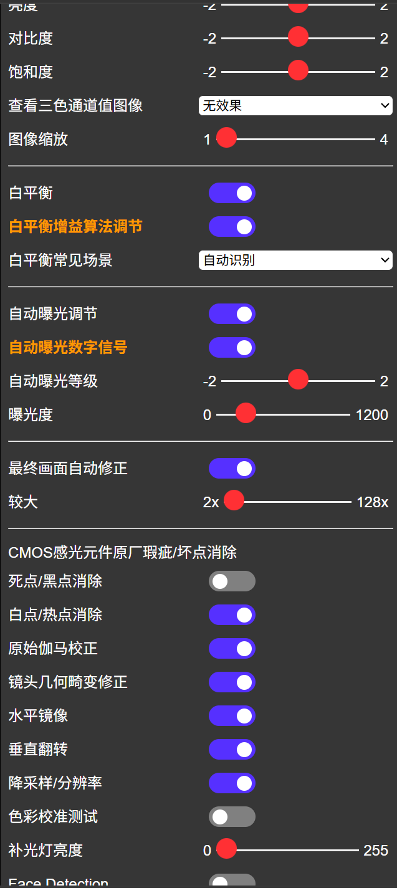

<h1>var-val数据传输链路</h1>

- [var-val请求 与 cmd\_uri域名大类](#var-val请求-与-cmd_uri域名大类)
- [逻辑传输链路](#逻辑传输链路)
  - [在开始之前，我们先纠正一下原函数中的两个小小的逻辑命名错误](#在开始之前我们先纠正一下原函数中的两个小小的逻辑命名错误)
    - [~~updatevalue~~,应该叫update\_value\_display\_on\_client\_side](#updatevalue应该叫update_value_display_on_client_side)
    - [~~updateConfig~~,应该叫read\_And\_Send\_Control\_to\_server](#updateconfig应该叫read_and_send_control_to_server)
  - [html页面代码呈现](#html页面代码呈现)
  - [js后端逻辑](#js后端逻辑)
    - [客户端的初始自检与对齐](#客户端的初始自检与对齐)
    - [元素事件的onchange监听与统一格式控制命令](#元素事件的onchange监听与统一格式控制命令)
    - [html页面元素的显示/隐藏逻辑](#html页面元素的显示隐藏逻辑)
  - [网络通信](#网络通信)
  - [parse解析信息的域名大类和绑定的函数（客户端解析）](#parse解析信息的域名大类和绑定的函数客户端解析)
  - [acutator单片机硬件层面操作](#acutator单片机硬件层面操作)
    - [利用strcmp解析对应命令](#利用strcmp解析对应命令)
    - [sensor\_t封装函数进行固件操作](#sensor_t封装函数进行固件操作)


首先需要明确的一点是
源代码中涉及 数值更改&读取 的指令有三条uri种类
分别是
```cpp
httpd_register_uri_handler(camera_httpd, &reg_uri);
httpd_register_uri_handler(camera_httpd, &greg_uri);
httpd_register_uri_handler(camera_httpd, &cmd_uri);
```
greg_uri和reg_uri所涉及的命令是非常底层的，需要对着固件物理地址和固态地址一点点编译的，具体到硬件地址的注册值和掩码的 数据修改与读取操作，属于是为原厂工作人员预留的开发接口\
详见
<a href="0.1基础概念and对项目的吐槽.md">0.1基础概念and对项目的吐槽.md</a>
中的```全信息传输链路的寻路方式 与 物联网-硬件的代码逻辑```\
总而言之和咱们的硬件开发，没有太大关系

# var-val请求 与 cmd_uri域名大类
相比之下，封装更为完善，命名规则更为明晰的
<div id="logo"><!--logo没有本地定义，不影响显示-->
    <label for="nav-toggle-cb" id="nav-toggle">&#9875;OV2640 设置菜单</label>
</div>
中的功能，更为完善，更适合我们作为高级功能的开发使用

其基础功能完善，包括下面的



等等功能他都支持，对我们的基础摄像头开发与画质调节绝对够用了\
（他还把三色通道也准备好了，以及硬件中自带的人脸识别功能，还包括LED补光灯等等，所以即使后期做图像识别也是绝对足够的）

<font color='red'>综上，这一张的笔记我会尽量写的比较详尽，同时做一些有关排版或者共方面的建议和拓展</font>

# 逻辑传输链路
按照我们之前说的
```
html -> js ---[http request]---> parse -> acutator
```
我们分为五个小节讲解数据的传输链路
1. html页面代码呈现
2. js后端逻辑\
   (1)客户端的初始自检与对齐\
   (2)元素事件的onchange监听与统一格式控制命令\
   (3)html页面元素的显示/隐藏逻辑
3. parse解析信息的域名大类和绑定的函数
4. acutator利用strcmp解析对应命令，
    并使用\
   ```sensor_t *s = esp_camera_sensor_get()```的封装函数进行固件操作

## 在开始之前，我们先纠正一下原函数中的两个小小的逻辑命名错误
### ~~updatevalue~~,应该叫update_value_display_on_client_side
这个函数只会（根据服务器读取到的数据）更新本地的数值显示，而不会发送修改命令
```js
  // 更新 UI 并同步到服务器
  // 这个函数的名字不叫updateValue，应该叫update_value_display_on_client_side
  // 他不会修改esp32的配置值，而是根据传入的value参数来更新UI显示状态
  const updateValue = (el, value, updateRemote) => {
    updateRemote = updateRemote == null ? true : updateRemote
    let initialValue
    if (el.type === 'checkbox') {
      initialValue = el.checked
      value = !!value
      el.checked = value
    } else {
      initialValue = el.value
      el.value = value
    }

    //根据初始值和当前值的对比，决定是否需要发送更新请求到服务器：是否需要进行UI联动显示/隐藏等操作
    if (updateRemote && initialValue !== value) {
      updateConfig(el);
    } 
  }
```

### ~~updateConfig~~,应该叫read_And_Send_Control_to_server
```js
  // 发送配置到服务器
  // read the element input type and its value of type-name
  // then send the config to server esp32cam 
  // esp32cam will update its varied variable and varied value
  // 所以不多说,应该改名为read_And_Send_Control
  function updateConfig (el) {
    let value
    switch (el.type) {
      case 'checkbox':
        value = el.checked ? 1 : 0
        break
      case 'range':
      case 'select-one':
        value = el.value
        break
      case 'button':
      case 'submit':
        value = '1'
        break
      default:
        return
        //注意js中case语法的顺延性
    }

    const query = `${baseHost}/control?var=${el.id}&val=${value}`

    fetch(query)
      .then(response => {
        console.log(`request to ${query} finished, status: ${response.status}`)
      })
  }
```


## html页面代码呈现
这个很简单，注意输入的几种形式就行
```html
<!-- checkbox -->
<input type="checkbox" id="nav-toggle-cb" checked="checked">

<!-- text -->
<input id="xclk" type="text" minlength="1" maxlength="2" size="2" value="20">

<!-- button -->
<button class="inline-button" id="set-xclk">设置</button>

<!-- selecy-option -->
<select id="framesize" class="default-action">
<option value="0">96x96</option>
<option value="1">QQVGA(160x120)</option>
<option value="2">QCIF(176x144)</option>
<option ... >... </option>
...
</select>

<!-- range -->
<div class="range-min">4</div>
<input type="range" id="quality" min="4" max="63" value="10" class="default-action">
<div class="range-max">63</div>

<!-- switch -->
<input id="awb" type="checkbox" class="default-action" checked="checked">
<label class="slider" for="awb">awb</label>
```
然后注意对应的xxx元素输入框排版，横板包裹或者并列之类的，是否需要类似
```html
<div class="input-group" id="xxx-group">
<input type="xxx" id="id" ...>
<!-- 注意input是无包裹元素，不需要在后面加上/input -->
</div>
```
之类的包裹确认索引位置，或者确认排版等等


## js后端逻辑
这一段逻辑作者有三种主要逻辑思路，分别对应
***开机连接的数值读取，数值变化的舰艇与数据发送，根据用户操作禁用或启用某些熟知的输入***
### 客户端的初始自检与对齐
```js
// 以及开机时候所有 default-action 元素的初始值读取和 服务端数据对齐-UI更新逻辑
// 读取初始值
fetch(`${baseHost}/status`)
.then(function (response) {
    return response.json()
})
.then(function (state) {
    document
    .querySelectorAll('.default-action')
    .forEach(el => {
        updateValue(el, state[el.id], false)
    })
})
```

通过将所有的基础输入值元素与<mark>class="default-action"</mark>绑定
，例如
```html
<select id="framesize" class="default-action">
<input type="range" id="quality" min="4" max="63" value="10" class="default-action">
<input id="awb" type="checkbox" class="default-action" checked="checked">
<input id="lenc" type="checkbox" class="default-action" checked="checked">
...
```

对应通过
```js
el => {updateValue(el, state[el.id], false)}
```
在读取到对应的参数值之后更新客户端本地显示的value

注意这里的***updatevalue***的函数名可能有点迷惑，这里给个注释\
更新 UI 并同步到服务器\
这个函数的名字不叫***updateValue***，应该叫***update_value_display***\
他不会修改esp32的配置值，而是根据传入的value参数来更新UI显示状态

### 元素事件的onchange监听与统一格式控制命令
```js
// 绑定所有 default-action 元素的 onchange 事件
// 这里的逻辑是，凡是带有 default-action 类的元素，在它们的值发生改变时，都会调用 updateConfig(el) 来把这个改变发送到服务器
document
.querySelectorAll('.default-action')
.forEach(el => {
    el.onchange = () => updateConfig(el)
    //任何foreach绑定了default-action的元素el，都会在onchange时
    //出发绑定的read_And_Send_Control_to_server修改服务器的值
})
```

### html页面元素的显示/隐藏逻辑
~~updateConfig~~，read_And_Send_Control_to_server原函数在最后还加了一段
```js
else if(!updateRemote){
      if(el.id === "aec"){
        value ? hide(exposure) : show(exposure)
      } else if(el.id === "agc"){
        if (value) {
          show(gainCeiling)
          hide(agcGain)
        } else {
          hide(gainCeiling)
          show(agcGain)
        }
      } else if(el.id === "awb_gain"){
        value ? show(wb) : hide(wb)
      } else if(el.id === "face_recognize"){
        value ? enable(enrollButton) : disable(enrollButton)
      } else if(el.id == "led_intensity"){
        value > -1 ? show(ledGroup) : hide(ledGroup)
      }
    }
```
与此同时，agc，aec，awb各家的还专门自己写了个
```js
  // 基础的画面调节功能-操作端逻辑 和 UI隐藏/展示联动逻辑
  // 这里因为同时用到了UI隐藏/展示联动逻辑，所以单独于上面的el.onchange = () => updateConfig(el)之外
  // 每个对应的功能aec，awb等等又写了一个函数专门来show/hide相关的UI元素
  // 自定义联动逻辑
  // 增益控制
  const agc = document.getElementById('agc')
  const agcGain = document.getElementById('agc_gain-group')
  const gainCeiling = document.getElementById('gainceiling-group')
  agc.onchange = () => {
    updateConfig(agc)
    if (agc.checked) {
      show(gainCeiling)
      hide(agcGain)
    } else {
      hide(gainCeiling)
      show(agcGain)
    }
  }

  // 曝光控制
  const aec = document.getElementById('aec')
  const exposure = document.getElementById('aec_value-group')
  aec.onchange = () => {
    updateConfig(aec)
    aec.checked ? hide(exposure) : show(exposure)
  }

  // 白平衡增益控制
  const awb = document.getElementById('awb_gain')
  const wb = document.getElementById('wb_mode-group')
  awb.onchange = () => {
    updateConfig(awb)
    awb.checked ? show(wb) : hide(wb)
  }
```
这就是这段代码的又一个坑\
作者应该在初始更新[客户端的初始自检与对齐](#客户端的初始自检与对齐)\
里面加上初始判断然后带上~~updateConfig~~，***read_And_Send_Control_to_server***里面的
```js
else if(!updateRemote){
      if(el.id === "aec"){
        value ? hide(exposure) : show(exposure)
      } else if(el.id === "agc"){
        if (value) {
          show(gainCeiling)
          hide(agcGain)
        } else {
          hide(gainCeiling)
          show(agcGain)
        }
      } else if(el.id === "awb_gain"){
        value ? show(wb) : hide(wb)
      } else if(el.id === "face_recognize"){
        value ? enable(enrollButton) : disable(enrollButton)
      } else if(el.id == "led_intensity"){
        value > -1 ? show(ledGroup) : hide(ledGroup)
      }
}
```
但是这作者懒到不行，直接在每一次***read_And_Send_Control_to_server***的时候问一遍要不要hide\
但是
```cpp
aec.onchange;
awb.onchange;
agc.onchange;
// 又分别自己定义又问一遍，妈的脱裤子放屁！
```
同时把对应类下的onchange任务，一半拆给自定义函数，一半在老地方继续用\
运行效率底下，代码逻辑混乱，纯屎，魔改人家的代码还没玩明白\
***
这里有两种解决方案：
1. 把~~updateConfig~~，***read_And_Send_Control_to_server***下面的onchange
    全部像```const element = document.getElementById```一样
    ```js
        // 单独拉一个document.getElementById读取状态
    const aec = document.getElementById('aec')
    const exposure = document.getElementById('aec_value-group')
        //然后el.onchange,写回调函数
    aec.onchange = () => {
    updateConfig(aec)
    aec.checked ? hide(exposure) : show(exposure)
    }
    ```
    逻辑清晰，但缺点是运行内存的占用会比较大
2. 一股脑全塞到***read_And_Send_Control_to_server***函数里面去\
    考虑到esp32cam仅有4Mb的内存，\
    这个运行和RAM占用都比较小的方法估计会比较合适具体的项目开发
***

## 网络通信
在
```js
el.onchange = () => read_And_Send_Control_to_server(el)
  function read_And_Send_Control_to_server (el) {
    let value
    value = el.value
    const query = `${baseHost}/control?var=${el.id}&val=${value}`
    fetch(query)
  }
```
之后，系统会发送以下大类的```uri=./control```域下的信息
```http
http://192.168.4.1/control?var=framesize&val=8        # 设置分辨率 (例如: 8 对应 VGA: 640x480)
http://192.168.4.1/control?var=quality&val=10         # 设置JPEG图片质量 (范围通常为4-63)
http://192.168.4.1/control?var=brightness&val=0       # 设置亮度 (-2 到 2)
...
```
其会被包装成为如下形式
```http
GET http://192.168.4.1/control?var=brightness&val=0 HTTP/1.1
Host: http://{YOUR_COMPUTER_id}/
User-Agent: Mozilla/5.0
Accept: */*
Connection: Keep-Alive
```


## parse解析信息的域名大类和绑定的函数（客户端解析）
我们根据<mark>/control</mark>为指引，在文件***app_httpd.cpp***\
中找到域名大类
```cpp
httpd_uri_t cmd_uri = {
    .uri = "/control",
    .method = HTTP_GET,
    .handler = cmd_handler,
    .user_ctx = NULL
#ifdef CONFIG_HTTPD_WS_SUPPORT
    ,
    .is_websocket = true,
    .handle_ws_control_frames = false,
    .supported_subprotocol = NULL
#endif
    };
```
并在服务器中完成此大类的注册(与处理函数绑定)
```cpp
log_i("Starting web server on port: '%d'", config.server_port);
if (httpd_start(&camera_httpd, &config) == ESP_OK)
{
    httpd_register_uri_handler(camera_httpd, &cmd_uri);
}
```


## acutator单片机硬件层面操作
### 利用strcmp解析对应命令
同样在文件***app_httpd.cpp***中, 找到其对应的处理函数<mark>.handler = cmd_handler,</mark>的定义如下
```cpp
static esp_err_t cmd_handler(httpd_req_t *req)
{
    // HTTP GET请求
    //     ↓
    // parse_get()              // 提取查询字符串 "var=framesize&val=10"
    //     ↓
    // httpd_query_key_value()  // 分离变量和值 → "framesize" 和 "10"
    //     ↓
    // atoi()                   // 字符串转整数 → 10
    //     ↓
    // strcmp()                 // 匹配参数名称 → 确认是"framesize"
    //     ↓
    // sensor_t *s = esp_camera_sensor_get()  // 获取传感器结构体
    //     ↓
    // s->set_framesize(s, 10)  // 调用对应函数实际配置硬件
    //     ↓
    // res接收返回值            // 获取配置结果（0=成功，-1=失败）
    //     ↓
    // if (res < 0)            // 检查配置结果
    //    → 返回HTTP 500错误
    // else
    //    → 返回HTTP 200成功

    // 至于404，log_i和log_e，ESP_FAIL啥的都是为了网络硬件连接诊断出错时及时判断问题所在
    char *buf = NULL;
    char variable[32];
    char value[32];

    if (parse_get(req, &buf) != ESP_OK) {
        return ESP_FAIL;
    }
    if (httpd_query_key_value(buf, "var", variable, sizeof(variable)) != ESP_OK ||
        httpd_query_key_value(buf, "val", value, sizeof(value)) != ESP_OK) {
        free(buf);
        httpd_resp_send_404(req);
        return ESP_FAIL;
    }
    free(buf);

    int val = atoi(value);
    log_i("%s = %d", variable, val);
    sensor_t *s = esp_camera_sensor_get();
    int res = 0;

    if (!strcmp(variable, "framesize")) {
        if (s->pixformat == PIXFORMAT_JPEG) {
            res = s->set_framesize(s, (framesize_t)val);
        }
    }
    else if (!strcmp(variable, "quality"))
        res = s->set_quality(s, val);
    else if (!strcmp(variable, "contrast"))
        res = s->set_contrast(s, val);
    else if (!strcmp(variable, "brightness"))
        res = s->set_brightness(s, val);
    else if (!strcmp(variable, "saturation"))
        res = s->set_saturation(s, val);
    else if (!strcmp(variable, "gainceiling"))
        res = s->set_gainceiling(s, (gainceiling_t)val);
    else if (!strcmp(variable, "colorbar"))
        res = s->set_colorbar(s, val);
    else if (!strcmp(variable, "awb"))
        res = s->set_whitebal(s, val);
    else if (!strcmp(variable, "agc"))
        res = s->set_gain_ctrl(s, val);
    else if (!strcmp(variable, "aec"))
        res = s->set_exposure_ctrl(s, val);
    else if (!strcmp(variable, "hmirror"))
        res = s->set_hmirror(s, val);
    else if (!strcmp(variable, "vflip"))
        res = s->set_vflip(s, val);
    else if (!strcmp(variable, "awb_gain"))
        res = s->set_awb_gain(s, val);
    else if (!strcmp(variable, "agc_gain"))
        res = s->set_agc_gain(s, val);
    else if (!strcmp(variable, "aec_value"))
        res = s->set_aec_value(s, val);
    else if (!strcmp(variable, "aec2"))
        res = s->set_aec2(s, val);
    else if (!strcmp(variable, "dcw"))
        res = s->set_dcw(s, val);
    else if (!strcmp(variable, "bpc"))
        res = s->set_bpc(s, val);
    else if (!strcmp(variable, "wpc"))
        res = s->set_wpc(s, val);
    else if (!strcmp(variable, "raw_gma"))
        res = s->set_raw_gma(s, val);
    else if (!strcmp(variable, "lenc"))
        res = s->set_lenc(s, val);
    else if (!strcmp(variable, "special_effect"))
        res = s->set_special_effect(s, val);
    else if (!strcmp(variable, "wb_mode"))
        res = s->set_wb_mode(s, val);
    else if (!strcmp(variable, "ae_level"))
        res = s->set_ae_level(s, val);
#if CONFIG_LED_ILLUMINATOR_ENABLED
    else if (!strcmp(variable, "led_intensity")) {
        led_duty = val;
        if (isStreaming)
            enable_led(true);
    }
#endif

#if CONFIG_ESP_FACE_DETECT_ENABLED
    else if (!strcmp(variable, "face_detect")) {
        detection_enabled = val;
#if CONFIG_ESP_FACE_RECOGNITION_ENABLED
        if (!detection_enabled) {
            recognition_enabled = 0;
        }
#endif
    }
#if CONFIG_ESP_FACE_RECOGNITION_ENABLED
    else if (!strcmp(variable, "face_enroll")){
        is_enrolling = !is_enrolling;
        log_i("Enrolling: %s", is_enrolling?"true":"false");
    }
    else if (!strcmp(variable, "face_recognize")) {
        recognition_enabled = val;
        if (recognition_enabled) {
            detection_enabled = val;
        }
    }
#endif
#endif
    else {
        log_i("Unknown command: %s", variable);
        res = -1;
    }

    if (res < 0) {
        return httpd_resp_send_500(req);
    }

    httpd_resp_set_hdr(req, "Access-Control-Allow-Origin", "*");
    return httpd_resp_send(req, NULL, 0);//记得给设备再返回一个全域访问权限
}
```
其主要操作就是那一堆strcmp确认命令类型
并进行相应的**固件-物理地址目录操作**或**外接硬件管理**

但他管理这一堆这个```strcmp```函数同样有值得说道的地方\
你知道的超过<font color="red">五个以上</font>**同类型if-else判断结构**不用**switch-case结构**,\
在标蠢的企业架构中基本就是要判死刑的,属于是要把九族连着这一堆代码一起cos商鞅\
但是这里就这么写了,反倒是更好的方法? 

你没看错就是更好的方法,原因无他


这玩意4MB的空间,还要塞库文件和启动文件,你猜猜有没有空间给你放多余的h标头?\
你猜猜他要是把这些空间给你用了,你有没有地方腾出来写外设的控制代码?\
不过考虑现在的占用也就50%左右,\
你要是写完外设的控制代码之后还有多余的空间,可以尝试用\
<a href="2.1var-va代码块修改建议.md">2.1var-va代码块修改建议.md</a>里面建议的枚举 + 映射表方法来规范代码


### sensor_t封装函数进行固件操作
这没啥好说的,他封装好了,到这里顺便总结一下,除去网络维护代码以外,起作用的就下面这几句话
```cpp
char *buf = NULL;
char variable[32];
char value[32];

httpd_query_key_value(buf, "var", variable, sizeof(variable)) != ESP_OK;
httpd_query_key_value(buf, "val", value, sizeof(value)) != ESP_OK;
free(buf);

if(strcmp(variable, "quality")){
int val = atoi(value);
sensor_t *s = esp_camera_sensor_get();
s->set_quality(s, val);
}
```
别他妈傻不拉几的用```Reg, Mask, Value```去"从沙子开始手搓芯片,从养生猪开始开餐馆"(当然如果你是华为那另说)
    

