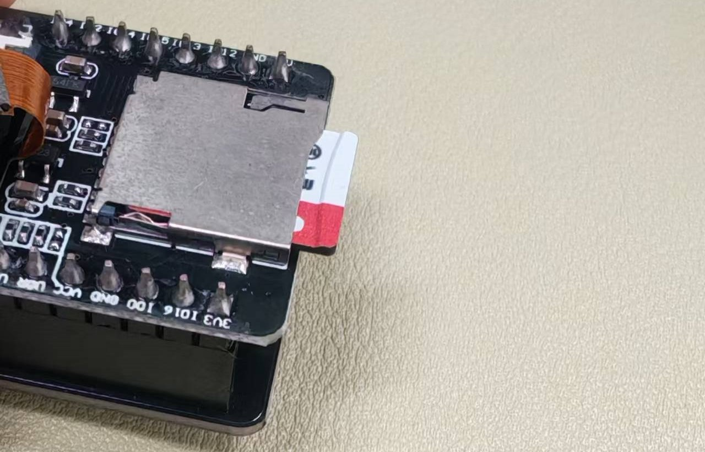
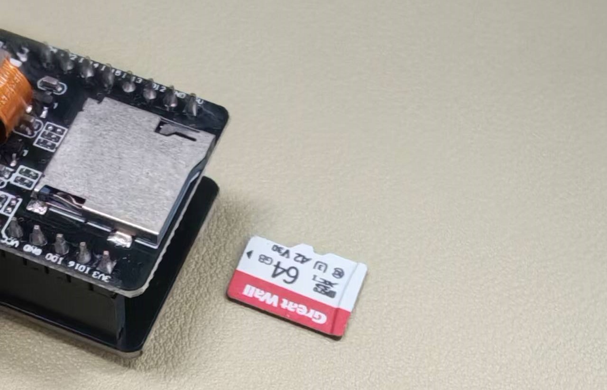

简单说一下我想加的两个功能

保存内容选择
1. 抓拍内容-jpg(这个好说, 双端都有现成代码)
2. 视频内容-avi(这涉及到一个问题就是mjpeg的流式数据stream有对应的格式吗?有的avi格式,不过转换工具和代码要花上一段时间了)

保存位置选择
1. 服务器本地保存(如果有PSRAM),客户端不保存
2. 服务器本地不保存,客户端保存(当未检测到PSRAM时自动执行此策略并在客户端的html页面hide 对应的switch-box)
3. 服务器本地保存(如果有PSRAM),客户端保存
(客户端的保存要怎么保持对窗口数据的持续截获,并在结束录像时选择保存地址,要写js脚本)


# 服务器本地保存录像内容
ESP32cam是自带有SD卡卡槽的,\



作者在2022的古早时期下载过的示例程序里面有一个sd卡存储的相关代码块\
其作用大概类似于在开启或关闭视频传输时,开始/结束将对应的stream传输内容存入TF卡中\
由于现在已经找不到当初的那段示例了,作者猜测其代码大概是下面这样的
```html
<button id="toggle-stream">实时图像数据流传输</button>
<script>
    const streamButton = document.getElementById('toggle-stream')
      streamButton.onclick = () => {
    const streamEnabled = streamButton.innerHTML === '停止图像传输'
        if (streamEnabled) {
        stopStream()
        TF.stopread(stream)
        } else {
        startStream()
        TF.read_and_write(stream,TF)
        }
    }
</script>
```

但是作者想要实现的功能不至于本地保存录像内容
而是双端都能做到保存图片或者录像内容
这就需要从客户端的前端到后端,到服务端都额外设计新的内容

- 客户端前端网页呈现:\
    设计两个switch按钮,分别代表
     1. 是否保存接下来的拍照\录像内容到客户端(浏览器)
     2. 是否保存接下来的拍照\录像内容服务端(esp32cam)
    设计一个录像与拍照按钮与一个switch按钮
     1. switch按钮用于切换拍照\录像模式
     2. 录像与拍照按钮共用一个位置,在switch按钮按下后切换显示样式为拍照或录像
- 客户端前端js交互逻辑:\
    前端的保存内容分为录像和图片
     1. 图片的保存任然沿用原来的download功能
     2. 录像的保存要怎么办? 还有多张mjepg的avi格式要怎么封装编码?
- 服务器后端:\
    后端的保存内容
     1. 统一写入TF卡, 需要用到```"FS.h" "SD_MMC.h" ```两个库中的内容
     2. 录像的内容一样需要封装, 在c中怎么封装

整体逻辑也就是


1. 在此基础上,进一步明确我们新增的功能的代码 的逻辑
    需要读取的用户输入需要\
    3个swtich: 按照原来的css样式+html设计写就行\
    1个button: 需要重新设计css样式,而且对应不同的任务状态还需要设计多款样式,\
    主要的工作量是美术问题...


2. 要在前端增加,及其功能被启用时需要读取的用户输入
        按照上面的逻辑,我们把摄像头的**"摄影动作"**和双端的**"保存动作"**集成到了一起
        对应的,我们设计报文的格式如下:
    ```http
    http:\\192.108.1.104\film?mode=cap&saverealm=server
    ```
    ```
    对应的, 摄像头的工作模式选择为mode: cap(capture)|rcd(record)
            保存位置选择为saverealm: server(SD.h)|client|both
    所以我们所发送的合法指令一共有6条
    ```
    ```http
    http:\\192.108.1.104\film?mode=cap&saverealm=server
    http:\\192.108.1.104\film?mode=cap&saverealm=client
    http:\\192.108.1.104\film?mode=cap&saverealm=both

    http:\\192.108.1.104\film?mode=rcd&saverealm=server
    http:\\192.108.1.104\film?mode=rcd&saverealm=client
    http:\\192.108.1.104\film?mode=rcd&saverealm=both
    ```
    client端的图片pic保存类似于之前示例代码的
    - capture_handler函数 +\<download\>, 但是我们需要做的是实时拍照功能,需要将其整合到一起
    - server端的图片pic保存本质是本地操作,不需要写responde, 唯一需要解决的问题是参数的传递,以及怎么存进SD.h
    - both则是吧两个功能塞到一起
    
    record的保存涉及到Mjepg->.avi的编码与封装, 
    - server端的保存还好说, avi编码封装+SD调用
    - client端的保存涉及到的一个问题是, stream视频流是实时传输, 不可能在录像结束后再把视频打包传输过来, 这样的话带宽肯定不够, 所以需要在ov2640的js端再写一个视频保存脚本, 在把对应时段的录像找一个缓冲点保存下来,并在录象完成后保存到本地(或者直接在开始录像时就选定保存位置? 然后直接传递数据?一般的js脚本是怎么解决这个问题的)
    - both的整合还比较麻烦,respond传回的数据要能够唤醒client的rcd保存功能


3. 在单片机部分需要增加的功能(需要用到的库以及具体怎么写),及其功能被启用时需要读取的用户输入


   