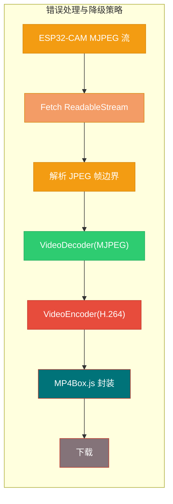

# 保存逻辑
视频流在持续传输的过程中, 客户端直接使用本地的录屏和下载功能?\
作者考虑了一下\
1. MJPEG的制作大小和运行内存占用,emm, 直接放弃了这个方案
2. 写一个mjpeg/avi->mp4的实时编码转换?更是不可能, 就算我写得出来浏览器也带不动...

~~就像我前面说的, 写到这我都打算直接弃坑, 转战ESP32CAM MB了, 毕竟这个库支持是真的拉到不行布响丸辣!!!~~\
但是作者发现自己平时用的edge居然破天荒的有一套原生的\
***VideoDecoder(MJPEG) → VideoEncoder(H.264)***
视频解码编码器

那还说啥了, 把这个功能先整完把(然后就弃坑投向MB的怀抱了)

# js整体逻辑


# html的img画框定义
**2640film-rcd.html**
```html
<!DOCTYPE html>
<html>
<head>
    <meta charset="UTF-8">
    <title>ESP32-CAM MP4 Recorder</title>
    <style>
        #preview { width: 640px; height: 480px; background: #333; }
        #status { font-family: monospace; margin: 10px 0; }
        button { padding: 10px 20px; margin: 5px; }
    </style>
</head>
<body>
    <h2>ESP32-CAM WebCodecs 录制器</h2>
    
    <!-- 预览用 img (MJPEG 流) -->
    
    
    <div>
        <button onclick="startRecording()">⏺ 开始录制 (MP4)</button>
        <button onclick="stopRecording()">⏹ 停止并下载</button>
    </div>
    
    <div id="status">未录制</div>

    <!-- 引入 MP4Box.js -->
    <script src="https://cdn.jsdelivr.net/npm/mp4box@0.5.2/dist/mp4box.all.min.js"></script>
    <script src="recorder.js"></script>
</body>
</html>
```

# JS代码讲解
参考[2640Recorder.js](2640Recorder.js)