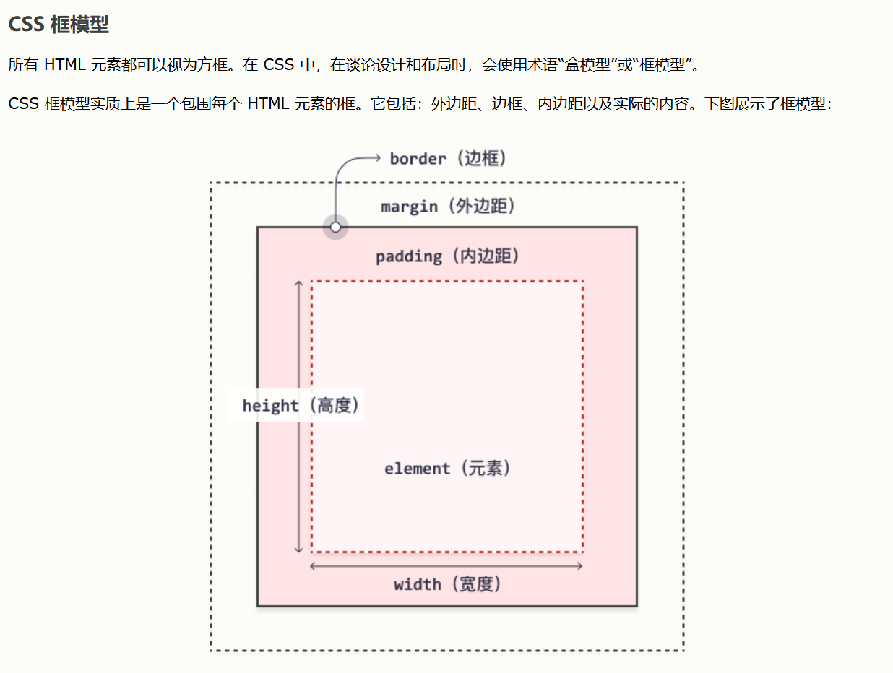

# 笔记
```html
<!DOCTYPE html>
<html lang="zh-CN">

<head>
    <meta charset="UTF-8">
    <meta name="viewport" content="width=device-width, initial-scale=1.0">
    <title>CSS学习笔记</title>
    <style class="页面布局讲解">
        body {
            font-family: Arial, Helvetica, sans-serif;
            /* font-size:100%; 利用此语句调整所有字体的大小 */
            background: #f0f0f0;
            color: #333;
            margin: 0;
            padding: 20px;
        }

        h1 {
            color: #007acc;
        }

        /* 三种大类的区别就不说了,
            想用 note.red-bold{},
            还是 #note{},
            又或者直接 note{}
            这些都随你,
        这玩意咱们有没有严格要求管理,更没有太多的同名复用,注意力放在内容上就好了 */


        /* 这是一个区块的专用样式,
            所以会特别讲解定位方式与尺寸控制等等语法 */

        #box-background {
            /* 背景的定义 */
            background: linear-gradient(to right, #ff7e5f, #feb47b);
            /* 线性渐变背景 */
            /* background: linear-gradient(to bottom, #003399, #ffffff); */
            /* 线性渐变背景 */
            /* background: gray; */
            /* 纯色背景 */
            /* background: black; */
            /* 纯色背景 */

            /* 或者直接定义背景图片 */
            background-image: url("image-2.jpg");
            /* 背景图片 */
            /* background: url('path/to/image.jpg') no-repeat center center; */
            /* 一般不用这种写法*/

            /* 背景的其他属性 */
            background-repeat: repeat-x;
            /* 背景在网页中未占满时的重复方式,常见的还有repeat-y以及no-repeat */
            background-position: center;
            /* 背景位置,常见的还有top, bottom, left, right, right top等等 */

            /* 设定背景图像随动或者固定位置 */
            background-attachment: fixed;
            /* 背景固定在视口 */
            /* background-attachment: flex; 作用同下 */
            /* background-attachment: scroll; 背景随内容滚动 */

            /* 或者上面的全部简写成一条 */
            background: #ffffff url("tree.png") no-repeat right top;
            /* 在使用简写属性时，属性值的顺序为：
            background-color
            background-image
            background-repeat
            background-attachment
            background-position
            属性值之一缺失并不要紧，只要按照此顺序设置其他值即可。
            请注意，在上面的例子中，我们没有使用 background-attachment 属性，因为它没有值。 */
        }

        box-border-outline {
            /* 边框样式 */
            border-style: inset;
            /* 常用样式
            dotted - 定义点线边框
            dashed - 定义虚线边框
            solid - 定义实线边框
            double - 定义双边框
            groove - 定义 3D 坡口边框。效果取决于 border-color 值
            ridge - 定义 3D 脊线边框。效果取决于 border-color 值
            inset - 定义 3D inset 边框。效果取决于 border-color 值
            outset - 定义 3D outset 边框。效果取决于 border-color 值
            none - 定义无边框
            hidden - 定义隐藏边框
            */

            border-width: 5px;
            /* border-width: 20px 5px; /* 上边框和下边框为 20px，其他边为 5px */
            /* border-width: 25px 10px 4px 35px; 上边框 25px，右边框 10px，下边框 4px，左边框 35px */
            border-color: #ff5733;

            border-radius: 10px;
            /* 圆角边框在拐角处的半径 */
            /* 或者上面的全部简写成一条 */
            border: 5px solid red;
            /*同样需要注意顺序*/

            /* outline是会向margin方向延伸的"轮廓" */
            outline-style: solid;
            outline-color: red;
            outline-width: thick;


            note:同样可以全部简写为如下形式;
            border: 5px inset red;
            outline: 10px outset blue;
            outline-offset: 5px;/* 在border和outline之间流5px的空白 */

        }


        box-edge-distance {
            /* CSS 外边距margin */
            margin-top: 100px;
            margin-bottom: auto;
            /* 自动计算外边距以使元素垂直居中 */
            margin-right: 10%;
            /* 右外边距为父元素宽度的10% */
            margin-left: inherit;
            /* 继承父元素的左外边距值 */
            /* 注意文本框某些情况下会发生边距合并 
            行内框、浮动框或绝对定位之间的外边距不会合并。*/

            /* 除了外部边框的宽度,你还可以通过以下语句设置内部边框的宽度 */
            padding-top: 50px;
            padding-right: 30px;
            padding-bottom: 50px;
            padding-left: 80px;

            note:"以及同样的,全部采用简写的方式";
            margin:200px 50px 100px 20px;
            /* 或者你只写margin:200px 50px; 那就是上下的外边距为200px，左右的外边距为50px */
            padding: 20px 30px 20px 80px;
            /* 同样需要注意顺序是顺时针走一圈 */

            /* 于此同时有些时候会通过某些属性来设定边距是相加还是内含 */
            box-sizing: border-box;
            /* 设定元素的宽度和高度是否包含内边距和边框 */
            /* 或者 box-sizing: content-box; 设定元素的宽度和高度不包含内边距和边框 */
            /* box-sizing: inherit; 继承父类 */

            /* 内容本体尺寸控制 */
            width: 300px;
            height: 200px;

            note:其空间关系可以参考
        }
    </style>

    <style class="文本样式与布局">
        text-box {
            /* 这是一个字段的专用样式,
            所以会特别讲解相关的颜色字体等等语法 */

            /* 设置框的大小, 以及文本在框内的对齐方式 */
            border: 1px solid black;
            padding: 10px;
            width: 200px;
            height: 200px;
            text-align: justify;
            /* 或者text-align: justify|right|center|left; 框内填充|左对齐|居中|右对齐*/
            text-decoration: underline;
            /* 或者 text-decoration: overline|line-through|underline; 上划线|删除线|下划线*/
            text-transform: capitalize;
            /* 大小写问题text-transform: uppercase|lowercase|capitalize; 大写|小写|首字母大写(标题格式)*/
            
            /* 文本缩进 */
            text-indent: 50px;
            /* 字母间距 */
            letter-spacing: 2px;
            /* 行高 */
            line-height: 1.2;
            /* 单词间距 */
            word-spacing: 5px;

            /* 文本的阴影效果 */
            text-shadow: 2px 2px 5px pink;
            /* 重影效果:向下移动2px  向左移动2px  重影字体的笔画粗细(字重)5px  重影字体的颜色pink  */


            /* 颜色的三种语法 */
            color: #ff5733;
            /* 16进制颜色 */
            background-color: aqua;
            /* 直接命名颜色 */
            border-bottom-color: rgba(0, 255, 255, 0.5);
            /* RGBA颜色 */

            /* 字体属性设置 */
            font-family: Arial,Helvetica,sans-serif;
            /* 字体系列 */
            font-size: 16px;
            /* 字体大小, 注意字体大小的几种单位,
            em px(这两在显示器分辨率和父元素不同的时候会反复横跳)
            vw rem 全称是view-window 和 Root-em, 
            会分别根据视窗的百分比和浏览器默认设置body的font-size来确认字体大小,兼容性最好,可以有效防止字体排版混乱
            */
            font-weight: bold;
            /* 字体粗细 */
            font-style: normal;
            /* 或者font-style: normal|italic|oblique; 需要注意粗体不是在这里设置而是上面的weight*/

            note: 一样可以简写,同样可以省略中间但是要注意顺序
            font: italic bold 5rem/5vw Arial, sans-serif;
            /* font 属性是以下属性的简写属性：
            font-style
            font-variant
            font-weight
            font-size/line-height
            font-family */


            /* 文本框大小啥的,参考上面的box设置方法
            margin: 10px;
            padding: 10px; */
        }
    </style>
        
    <style class="超链接样式定义">
        /* 链接样式的定义 */
        a:link {color: red;}
        a:visited {color: green; text-decoration: underline;}
        a:hover {color: hotpink;}
        a:active {color: blue; background-color: cyan;}
    </style>


    <style class="一些文本排版的小花样">
        /* 列表 */
        maroon-box {
            backgroun: #ff9999;
            padding: 20px;
        }
        maroon-box pink-list{
            background: #ffe5e5;
            padding: 5px;
            margin-left: 35px;
        }
    </style>

    /* 使用示例如下 */
    <maroon-box>助你练成单杠3
        <pink-list>澳式引体10个 x 3组<\pink-list>
        <pink-list>吊杠支撑30s x 3组<\pink-list>
        <pink-list>吊杠沉肩15个 x 3组<\pink-list>
        <pink-list>离心下方8个 x 3组<\pink-list>
    </maroon-box>

    <style class="相对定位方法position 与 z-index">
    /* 首先我们要明确一个概念
    我们看到的"页面page"是一定要大于"窗口window"的
    即使window的px达到了1660k,page的定位也会全部渲染到window的边界值
    而更多情况下,window受限于窗口大小与屏幕大小
    我们的page"所需要包含的基础内容"所要求的pixel是一定会比"window"大的

    在此基础上,我们的定位方法分为几个大类
    1. 相对page的定位(世界坐标系定位)
        1)relative  (相对页面的左上角为坐标原点,输入坐标轴系数定位)
        2)fixed     (相对页面的右下角为坐标原点,输入坐标轴系数定位)
    2. 相对window的定位(窗口-本地坐标系定位)
        3)absolute  (相对所在div内的div作为父类元素,相对其位置参考定位)
        4)sticky    (相对窗口的)
    3. 绝对定位
        5)static    (每个div重启一行,正常的文本排版方式)
     */

    /* 例如 */
    box-location.top-left{
    position: relative;
    top: 0;
    left: 30px;
    }
    box-location.bottom-right{
    position: fixed;
    bottom: 300px;
    right: 300px;
    }

    /* 特别讲解一下sticky */
    box-location.sticky{
    position: sticky;
    top: 0;
    /* 当这个div块并不直接放在最上面时,
    你在没滑到他所在位置的时候, 他会停留在原地, 
    但是当你的window低于其在page中所在的div位置时,其会stick到你的window的顶端 
    
    所以如果你想把某个元素直接在开始时就粘黏到window的对应位置时
    (例如一般滑动页面的回到顶端)
    应该像下面这么写
    (下面的元素放在所有div的前面,页面页面中第一个div的位置)
    box-location.sticky{
    position: sticky;
    bottom: 0;
    }
    */
    }

    /* 懒得理解这么复杂的位置也没关系, 你就记住relative和page绑定,sticky和窗口绑定 */
    /* 然后在不侵犯已有上方div框的情况下,绝对剧中就是position: absolute; left: 50%; top: auto; */
    /* 最多absolute绑定一下父类的相对位置 */
    </style>


    
    <style class="显示效果display">
        box-diplay{
            margin: 30px;
            padding: 20px;
            border: 5px inset red;
            outline: 10px outset blue;
            display: none|hidden|inline|block;/*不显示|隐藏|和上一个div共享一行|单独区块(默认值)*/
        }
    </style>


    上面的display:inline-block的行内并排使用方法
    <页内滚轮框>
    <图片浮动与防止浮动>

</head>

<body>

</body>

</html>


```
